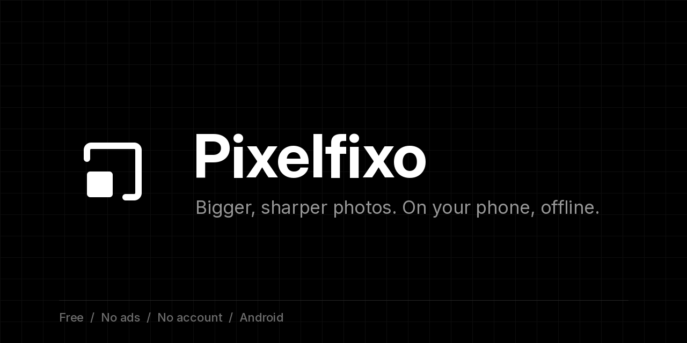
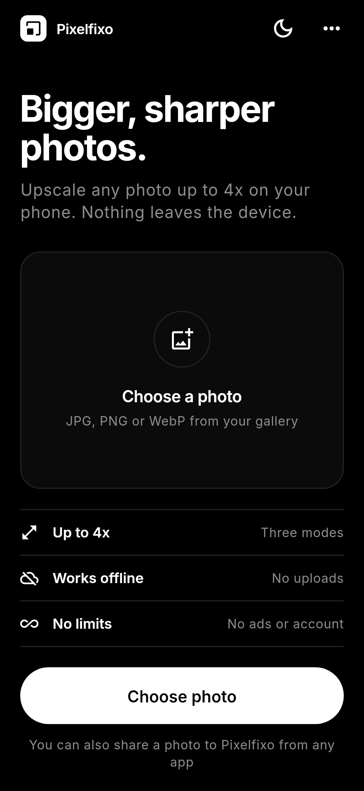
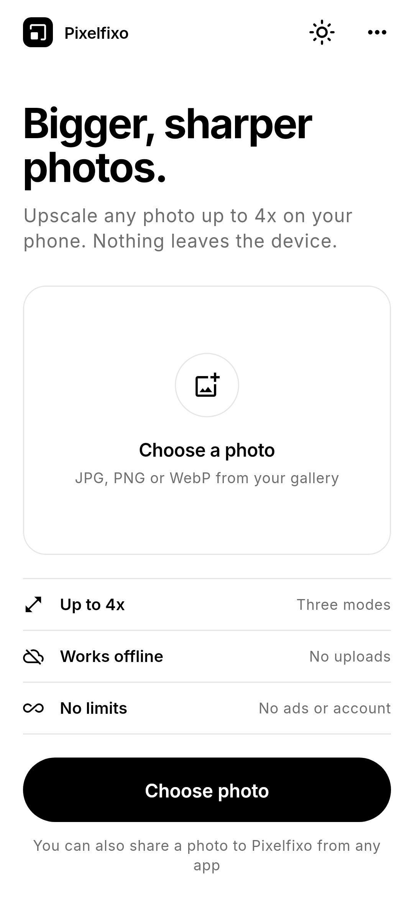
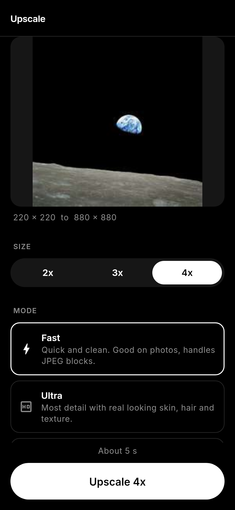
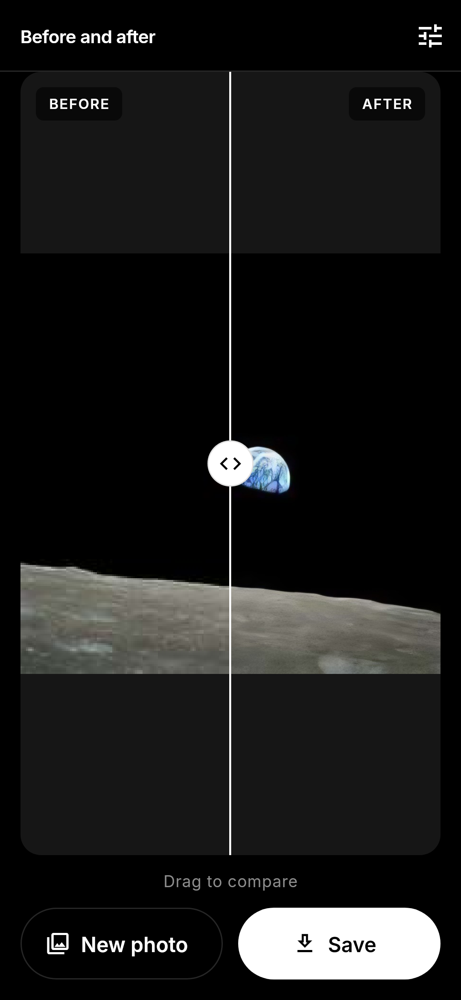
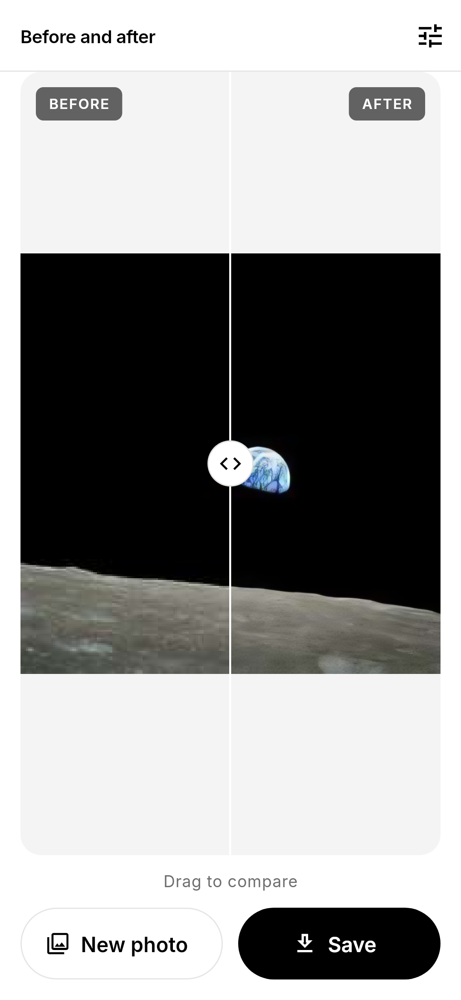

<p align="center"></p>

<p align="center">
  <a href="https://github.com/Alokxyz1112/pixelfixo/releases/latest"></a>
  
  
</p>

# Pixelfixo

Make small photos big and sharp, right on your phone. Pick a photo (or share one to Pixelfixo from any app), choose 2x, 3x or 4x, drag the slider to compare, save. That's it.

No account, no ads, no watermark, no daily limits. Nothing gets uploaded. Once the models are on your phone it works in airplane mode.

## Screenshots

| Home | Light | Options | Compare | Compare, light |
|---|---|---|---|---|
|  |  |  |  |  |

The screenshots are rendered from the real widgets with Flutter golden tests (`test/screenshots_test.dart`). The "after" image there is real output from Fast mode.

## Features

- **Three modes.** Fast for everyday photos, Ultra for the most detail, Art for drawings, anime and memes.
- **2x, 3x, 4x.**
- **Natural or Sharp look.** Natural keeps skin and textures soft and believable. Sharp pushes edges harder.
- **Restore color.** Keeps the colors and skin tones of your original instead of letting them drift.
- **Film grain.** A light grain so big flat areas don't look plastic.
- **JPEG cleanup.** Blocky, over-compressed photos get cleaned up automatically.
- **Before and after slider** with pinch to zoom.
- **Clean saves.** Output is a plain PNG in Pictures/Pixelfixo with no metadata carried over.
- **Share to Pixelfixo** from your gallery, browser or chat app.
- **Dark and light themes,** or follow the system.
- **Fully offline** after a one time download for Ultra (about 30 MB) or Art (about 18 MB).
- **Open source licenses** are listed in the app under the menu on the home screen.

## Build it yourself

You need Flutter 3.x (stable) and the Android SDK.

```sh
git clone https://github.com/Alokxyz1112/pixelfixo
cd pixelfixo
flutter pub get
flutter test
flutter build apk --release --split-per-abi --target-platform android-arm64
```

For a signed release build, create `android/key.properties` (or set `PIXELFIXO_KEY_PROPS` to its path) with `storeFile`, `storePassword`, `keyAlias` and `keyPassword`. Without it the build falls back to debug signing. Keep your keystore out of the repo.

To regenerate the logo and icons: `python tool/make_logo.py` (needs cairosvg and Pillow), then `dart run flutter_launcher_icons`.

## License

The app code is MIT.

Uses open-source components; see [THIRD_PARTY.md](THIRD_PARTY.md) for licenses and credits.
